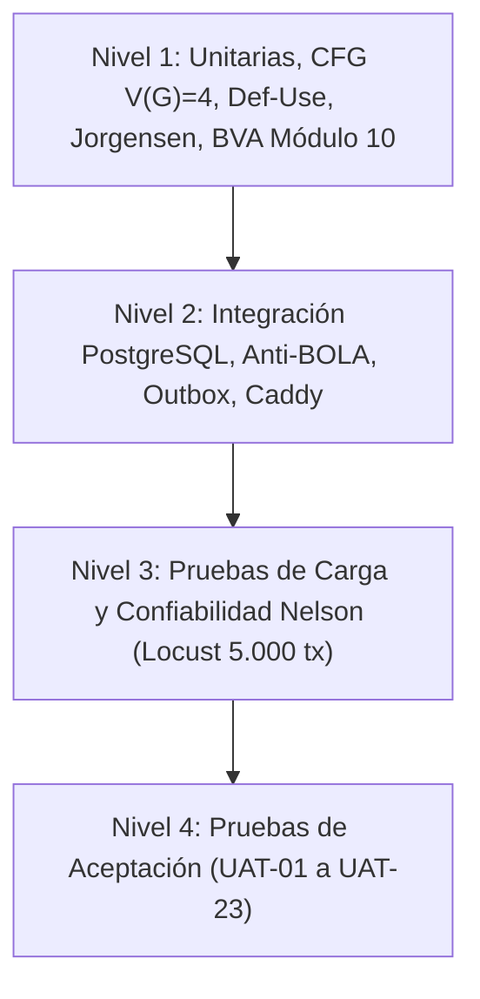

# Plan Maestro de Pruebas de Software (IEEE 829-2008)

* **Identificador del Documento:** `SIGAD-TP-001`
* **Proyecto:** Sistema Integral de Gestión de Asegurados (SIGAD) — RJ Seguros
* **Asignatura de Referencia:** SOFG1008 Ingeniería de Software II
* **Versión:** 1.0.0
* **Fecha:** 2026-09-30
* **Estado:** `APROBADO`

---

## 1. Introducción y Propósito

El presente documento define la estrategia integral, el alcance, los recursos, las compuertas de verificación y la matriz de trazabilidad formal para las actividades de Verificación y Validación (V&V) del proyecto **SIGAD**, asegurando el cumplimiento estricto del estándar **IEEE 829-2008**.

El objetivo primario es garantizar que la plataforma web y móvil de RJ Seguros cumpla con los atributos de confiabilidad ($R \ge 0.995$ bajo el modelo de Nelson), integridad transaccional, seguridad estructural y compatibilidad funcional con la normativa ecuatoriana (ANT, SRI, Ley de Protección de Datos Personales).

---

## 2. Ítems de Prueba

| Identificador del Ítem | Módulo / Componente | Tecnologías Clave | Tipo de Artefacto |
| :--- | :--- | :--- | :--- |
| **IT-01** | Core API & Autenticación | FastAPI, Argon2id, JWT, SQLAlchemy | Código fuente Backend |
| **IT-02** | Motor de Pólizas & CFG | Python 3.12, CFG V(G)=4, Def-Use | Dominio Puro |
| **IT-03** | Worker Asíncrono & Outbox | Tesseract 5, pdfplumber, pypdfium2 | Worker Daemon |
| **IT-04** | Base de Datos Relacional | PostgreSQL 16, Migraciones Alembic | Esquema y Triggers |
| **IT-05** | Cliente Web & Dashboard | Flutter Web, BLoC, HTTP Client | SPA Web |
| **IT-06** | Aplicación Móvil Cliente | Flutter Mobile (Android/iOS) | App Nativa |

---

## 3. Características a Probar (Features to be Tested)

1. **Autenticación Polimórfica Segura:** Login con email para personal interno y con cédula ecuatoriana para asegurados, con verificación en tiempo constante (`hmac.compare_digest`).
2. **Evaluador de Pólizas y Dominio CFG:** Cobertura de las 4 rutas base del Grafo de Flujo de Control con sumidero virtual de excepciones ($V(G) = 4$).
3. **Análisis de Flujo de Datos (Def-Use):** Ausencia demostrada de anomalías UR (Undefined-Referenced), DU (Defined-Unused) y DD (Defined-Defined).
4. **Validación de Entradas ANT y Módulo 10:** Algoritmo estricto para cédulas de 10 dígitos y formatos de placas vehiculares ecuatorianas (autos particulares, motos, servicio público).
5. **Aislamiento Multi-inquilino (Anti-BOLA/IDOR):** Imposibilidad de que un cliente consulte pólizas o vehículos ajenos mediante filtros a nivel de consulta SQL.
6. **Pipeline OCR Resiliente:** Extracción a 200 DPI con compuerta dual y desasignación explícita de buffers en memoria C++.
7. **Tabla de Decisión Canónica de Jorgensen:** Las 5 reglas de negocio para aprobación y revisión de siniestros.
8. **Confiabilidad Estocástica de Nelson:** Tasa de éxito $R \ge 0.995$ en 5.000 transacciones concurrentes con Locust.

---

## 4. Características No a Probar (Features Not to be Tested)

1. Pasarelas de cobro bancario con dinero real (se utilizan emuladores sandbox de tarjetas de crédito/débito).
2. Biometría facial nativa de dispositivos móviles (delegada a los SDKs certificados de Android Keystore / iOS Keychain).

---

## 5. Estrategia y Niveles de Prueba

### 5.1 Pruebas Estructurales y de Caja Blanca (Nivel 1)
- **Cálculo de Complejidad Ciclomática:** $V(G) = E - N + 2P = 13 - 11 + 2(1) = 4$.
- **Rutas Base Independientes:**
  - *Ruta 1:* Fechas inconsistentes $\rightarrow$ `FechaInvalidaException`.
  - *Ruta 2:* `fecha_inicio > hoy` $\rightarrow$ `pendiente`.
  - *Ruta 3:* `fecha_fin < hoy` $\rightarrow$ `vencida`.
  - *Ruta 4:* `fecha_inicio <= hoy <= fecha_fin` $\rightarrow$ `activa`.
- **Análisis de Anomalías Def-Use:** Validación estática con AST para certificar la inexistencia de caminos anómalos.

### 5.2 Pruebas de Caja Negra y Valores Límite (Nivel 2)
- Partición de equivalencia en cédulas (provincias 01 a 24, tercer dígito < 6, algoritmo de Luhn módulo 10).
- Análisis de valores límite en vigencias (límite inferior hoy - 1 día, exacto hoy, hoy + 5 años).

### 5.3 Pruebas de Confiabilidad y Rendimiento (Nivel 3)
- Modelo de Nelson: $R = 1 - \frac{f}{n}$ evaluado sobre $n = 5.000$ peticiones estocásticas mediante Locust headless con 50 usuarios concurrentes.

---

## 6. Criterios de Paso y Fallo (Verification Gate)

Un ciclo de integración se considerará **APROBADO** si y solo si:
1. El 100% de los **37 tests obligatorios** pasan exitosamente en Pytest.
2. `flutter analyze` reporta **cero** advertencias o errores de tipado estricto.
3. El contrato OpenAPI exportado presenta cero drift (`git diff --exit-code openapi.json`).
4. El Modelo de Nelson alcanza $R \ge 0.995$ sin errores HTTP 5xx.
5. Las actas de inspección formal IEEE 1028 cuentan con dictamen unánime de aprobación.

---

## 7. Matriz de Trazabilidad Completa (Requerimientos $\leftrightarrow$ UAT $\leftrightarrow$ Pruebas)

| Requerimiento Funcional | Caso de Aceptación (UAT) | Módulo Automatizado de Verificación | Resultado Formal |
| :--- | :--- | :--- | :---: |
| **HU-01: Login web** | `UAT-01` | `tests/unit/test_security/test_login_polimorfico.py` | **PASS** |
| **HU-02: Registrar cliente** | `UAT-02` | `tests/unit/test_validation/test_ecuadorian_id.py` | **PASS** |
| **HU-03: Registrar vehículo** | `UAT-03` | `tests/unit/test_validation/test_plates.py` | **PASS** |
| **HU-04: Registrar póliza** | `UAT-04` | `tests/unit/test_domain_cfg.py` | **PASS** |
| **HU-05: Carga documentos** | `UAT-05` | `tests/unit/test_workers/test_extraccion_200_dpi_liberacion_memoria.py` | **PASS** |
| **HU-06: Revisión OCR** | `UAT-06` | `tests/unit/test_quality/test_decision_table.py` | **PASS** |
| **HU-07: Modificar póliza** | `UAT-07` | `tests/integration/test_kilometraje_snapshot.py` | **PASS** |
| **HU-08: Desactivar póliza** | `UAT-08` | `tests/integration/test_actualizacion_estados_poliza.py` | **PASS** |
| **HU-09: Búsqueda indexada** | `UAT-09` | `tests/integration/test_polizas_api.py` | **PASS** |
| **HU-10: Estados póliza** | `UAT-10` | `tests/unit/test_workers/test_scheduler_transiciones_completas.py` | **PASS** |
| **HU-11: Catálogo talleres** | `UAT-11` | `tests/integration/test_polizas_api.py` | **PASS** |
| **HU-12: Asistencias** | `UAT-12` | `tests/integration/test_polizas_api.py` | **PASS** |
| **HU-13: Login móvil** | `UAT-13` | `tests/unit/test_security/test_login_movil_por_cedula.py` | **PASS** |
| **HU-14: Pólizas cliente** | `UAT-14` | `tests/integration/test_bola_query_level.py` | **PASS** |
| **HU-15: Detalle póliza** | `UAT-15` | `tests/integration/test_migracion_deducibles_historicos.py` | **PASS** |
| **HU-16: Vehículo cliente** | `UAT-16` | `tests/integration/test_documentos_api.py` | **PASS** |
| **HU-17: Coberturas** | `UAT-17` | `tests/integration/test_polizas_api.py` | **PASS** |
| **HU-18: Vigencia ECT** | `UAT-18` | `tests/unit/test_domain/test_poliza_activa.py` | **PASS** |
| **HU-19: Alerta vencimiento** | `UAT-19` | `tests/unit/test_workers/test_scheduler_transiciones_completas.py` | **PASS** |
| **HU-20: Consulta pagos** | `UAT-20` | `tests/integration/test_polizas_api.py` | **PASS** |
| **HU-21: Talleres móviles** | `UAT-21` | `tests/integration/test_polizas_api.py` | **PASS** |
| **HU-22: Emergencias** | `UAT-22` | `tests/integration/test_polizas_api.py` | **PASS** |
| **HU-23: Contacto soporte** | `UAT-23` | `tests/integration/test_polizas_api.py` | **PASS** |

---

## 8. Aprobación del Plan Maestro

* **Responsable QA & V&V:** — *Aprobado*
* **Líder de Desarrollo Backend:** — *Aprobado*
* **Arquitecto Frontend:**  — *Aprobado*
* **Product Owner (RJ Seguros):**  — *Aprobado*
