# Estrategia de Respaldos, Cifrado GPG y Recuperación ante Desastres (PITR)

* **Código de Documento:** `SIGAD-OPS-002`
* **Sistema:** Base de Datos Relacional PostgreSQL 16 (SIGAD — RJ Seguros)
* **Herramienta Primaria:** `pgBackRest`
* **Estándar de Seguridad:** Cifrado asimétrico GPG / AES-256 en reposo

---

## 1. Objetivos del Servicio (RPO y RTO)

* **Recovery Point Objective (RPO):** $\le 5\text{ minutos}$ (Garantizado por archivado continuo de Write-Ahead Logging - WAL).
* **Recovery Time Objective (RTO):** $\le 60\text{ minutos}$ (Restauración completa de 100 GB en servidor de contingencia).
* **Retención:** 30 días en disco local, 365 días en repositorio secundario en la nube con inmutabilidad (*Object Lock / WORM*).

---

## 2. Esquema y Frecuencia de Respaldos

```mermaid
gantt
    title Cronograma Típico de Copias de Seguridad
    dateFormat  HH:mm
    axisFormat  %H:%M
    section Domingos
    Respaldo Full pgBackRest (Cifrado GPG) :done, 02:00, 90m
    section Lunes a Sábado
    Respaldo Diferencial (Cifrado GPG)    :active, 02:00, 30m
    section Continuo (24/7)
    Archivado de Segmentos WAL (16 MB)     :crit, 00:00, 1440m
```



1. **Respaldo Completo (Full Backup):** Ejecutado semanalmente cada domingo a las 02:00 UTC-5.
2. **Respaldo Diferencial (Differential Backup):** Ejecutado de lunes a sábado a las 02:00 UTC-5 (almacena únicamente bloques modificados desde el último Full).
3. **Archivado Continuo de WAL:** Cada archivo WAL de 16 MB se comprime con LZ4, se cifra con clave GPG pública y se envía inmediatamente al repositorio.

---

## 3. Configuración de `pgbackrest.conf`

```ini
[global]
repo1-path=/var/lib/pgbackrest
repo1-cipher-type=aes-256-cbc
repo1-cipher-pass=ENV:PGBACKREST_CIPHER_PASS
repo1-retention-full=4
repo1-retention-diff=14
process-max=4
log-level-console=info
log-level-file=detail
start-fast=y
compress-type=lz4
compress-level=3

[sigad-cluster]
pg1-path=/var/lib/postgresql/data
pg1-user=postgres
pg1-port=5432
```

---

## 4. Cifrado Asimétrico con GPG

Para cumplir con la Ley Orgánica de Protección de Datos Personales del Ecuador, los dumps y snapshots secundarios exportados hacia almacenamiento externo se cifran mediante par de claves GPG:

```bash
# 1. Exportación y cifrado asimétrico en tubería (pipe) sin tocar disco en plano:
pg_dump -h localhost -U sigad -d sigad_db -F c \
  | gpg --encrypt --recipient "seguridad@rjseguros.ec" --output /backups/sigad_dump_$(date +%F).pgdump.gpg

# 2. Verificación de integridad SHA-256 del archivo cifrado:
sha256sum /backups/sigad_dump_*.pgdump.gpg > /backups/checksums_$(date +%F).sha256
```

---

## 5. Procedimiento de Recuperación ante Desastres (PITR)

### 5.1 Restauración a un Punto Temporal Específico (Point-In-Time)

Si ocurre una corrupción de datos a las `14:32:00`, se puede restaurar el clúster exactamente al estado de las `14:30:00`:

```bash
# 1. Detener el servicio PostgreSQL
systemctl stop postgresql

# 2. Ejecutar restauración Point-In-Time con pgBackRest
sudo -u postgres pgbackrest --stanza=sigad-cluster \
  --type=time \
  --target="2026-09-30 14:30:00-05" \
  --target-action=promote restore

# 3. Iniciar el servicio y validar consistencia
systemctl start postgresql
```

### 5.2 Simulacros de Recuperación Periódicos

* Se ejecutan automáticamente cada 15 días en un contenedor aislado de staging.
* Se valida la consistencia referencial ejecutando la suite de pruebas unitarias e integración:
  ```bash
  cd backend && PYTHONPATH=. .venv/bin/pytest tests/integration/
  ```
